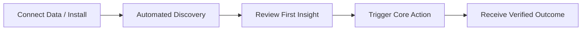

# Market Opportunity Research Report: [Proposed Concept Name]

> **Status**: `draft` | `accepted` (Human owner sets to accepted)  
> **Date**: `YYYY-MM-DD`  
> **Evaluator**: `market-opportunity-research` orchestrator  
> **Evidence Ledger**: [evidence-ledger.md](evidence-ledger.md)  
> **Validation Experiments**: [validation-experiments.md](validation-experiments.md)  

---

## 1. Executive recommendation

- **Verdict**: `Build a focused MVP` | `Validate further` | `Narrow or reposition` | `Do not build yet`
- **Core Rationale**: [Concise 2–3 sentence synthesis grounded in verified findings]
- **Critical Blocker Assessment**: [State clearly whether any fatal blockers exist. A fatal blocker overrides all positive scores.]
- **Recommendation Summary**:
  - *Primary opportunity*: [Who is the ideal customer and what is the burning pain?]
  - *Biggest vulnerability*: [Main red-team finding or unverified risk]
  - *Immediate next gate*: [Next required human action or cheap validation experiment]

---

## 2. Research scope, assumptions, geography, and limitations

- **Target Concept**: [Description of proposed product]
- **Target Geography & Language**: [e.g. US/North America, English-first]
- **Target Segments Investigated**: [Primary and secondary customer profiles]
- **Core Research Tools Used**: [Web searches, live HTTP content extraction, browser inspection, official filings]
- **Disclosed Limitations & Workstreams**: [State which agents ran, data availability limits, search constraints]
- **Explicit Assumptions**: [List all starting assumptions held prior to empirical validation]

---

## 3. Customer problem evidence and existing workarounds

- **Target Persona & Job-To-Be-Done (JTBD)**:
  - *Buyer*: [Title/Role, budget authority]
  - *End User*: [Daily workflow user]
  - *Core JTBD*: [When [situation], I want to [motivation], so that [outcome]]
- **Problem Severity & Frequency**:
  - *Frequency*: [Daily / Weekly / Monthly / Ad-hoc] (Cites `FND-NNN`)
  - *Urgency & Cost of Status Quo*: [Financial, time, or compliance cost of leaving problem unsolved]
- **Existing Workarounds & Inertia**:
  - [Manual spreadsheets / in-house bash scripts / multi-tool patchwork]
  - Why workarounds persist: [Switching friction, lack of awareness, inertia]
- **Representative vs. Anecdotal Evidence**:
  - *Representative patterns*: [Widespread industry data, recurring forum clusters]
  - *Anecdotal outliers*: [Single user complaints or extreme edge cases]

---

## 4. Competitor landscape and comparison matrix

| Competitor / Alternative | Category (Direct / Indirect / Open Source / Status Quo) | Target Segment | Core Workflow & Strengths | Pricing Model | Key Integrations | Notable Limitations / Gaps | Source Link |
| :--- | :--- | :--- | :--- | :--- | :--- | :--- | :--- |
| **[Competitor A]** | Direct | [Segment] | [Workflow] | [e.g. $49/mo/seat] | [Integrations] | [Limitation] | [Link](https://...) |
| **[Competitor B]** | Indirect | [Segment] | [Workflow] | [e.g. Free OSS] | [Integrations] | [Limitation] | [Link](https://...) |
| **[Alternative C]** | Status Quo | [Segment] | [Spreadsheets] | $0 direct / high labor | N/A | Error-prone, slow | Internal |

---

## 5. Pricing and packaging comparison

- **Market Pricing Norms**:
  - *Typical pricing metric*: [Per seat / Per month / Usage-based compute / Tiered platform]
  - *Entry tier median*: [$X/month] (Cites `FND-NNN`)
  - *Growth/Team tier median*: [$Y/month]
  - *Enterprise floor*: [$Z/year]
- **Packaging Analysis**:
  - Free tier / Trial conventions: [Freemium vs 14-day reverse trial vs contact sales]
  - Gatekeeper features: [SSO, audit logs, custom roles, dedicated support, API rate limits]
- **Buyer Budget Alignment**:
  - Discretionary credit card spend limit vs formal procurement approval thresholds.

---

## 6. Customer dissatisfaction patterns and potential unmet needs

| Pain Pattern ID | Recurring Frustration Description | Customer Segment Affected | Verbatim Evidence Quote (Short) | Current Competitor Response | Verified Unmet Need? (Yes / No / Partial) |
| :--- | :--- | :--- | :--- | :--- | :--- |
| `DISSAT-001` | [Slow performance / complex setup] | [SMB DevOps] | "[Quote from public review/forum]" | [Ignore / Paid add-on] | [Analysis: Is it genuine demand or edge case?] |

> [!CAUTION]
> **Golden Rule of Gap Analysis**: A missing feature in competitor products does not automatically prove market demand. Competitors may have intentionally excluded it due to low willingness to pay, high maintenance burden, or architectural trade-offs.

---

## 7. Opportunity shortlist

Ranked evaluation of potential product wedges:

1. **Opportunity 1: [Name]** *(Rank: High / Primary)*
   - *Rationale*: [Why this wedge offers the best balance of pain severity and differentiation]
   - *Supporting Evidence*: Cites `FND-NNN`
2. **Opportunity 2: [Name]** *(Rank: Medium / Secondary)*
   - *Rationale*: [Trade-offs and why it is secondary]
3. **Opportunity 3: [Name]** *(Rank: Low / Deprioritized)*
   - *Rationale*: [Why this option is rejected or deferred]

---

## 8. Recommended positioning and differentiation

- **Recommended Positioning Statement**:
  > For **[target buyer]** who struggle with **[unmet customer pain]**, our product is a **[product category]** that delivers **[primary outcome]**. Unlike **[primary competitor/alternative]**, our product **[core evidence-backed differentiator]**.
- **Differentiation Vectors**:
  - *Vector 1 (e.g. Niche specialization)*: [Details]
  - *Vector 2 (e.g. 10x faster workflow)*: [Details]
- **Defensibility Against Fast Follows**:
  - Why incumbents cannot easily duplicate within 6 months: [Data network effect, proprietary parser, distribution alignment, niche focus].
- **Falsifiable Positioning Assumptions**:
  - Assumption 1: [What must be true for this positioning to hold?]
  - Invalidation trigger: [What would prove this positioning wrong?]

---

## 9. Business model, pricing hypotheses, and unit economics

### Pricing Hypotheses
- **Tier 1 (Starter/Solo)**: [$X / month] — [Key limits: N seats, X operations]
- **Tier 2 (Pro/Team)**: [$Y / month] — [Team collaboration, standard integrations]
- **Tier 3 (Enterprise)**: [$Z / year] — [SSO, compliance, custom SLAs]

### Unit Economics & COGS Breakdown (Per Active Account / Month)
- Hosting & Infrastructure compute: `$A`
- AI Model / API token costs: `$B`
- Third-party data services / APIs: `$C`
- Support & Payment processing: `$D`
- **Total COGS per account**: `$E`
- **Gross Margin Estimate**: `[(Price - COGS) / Price]` = `X%` *(Target > 70%)*

### Financial Scenarios (Year 1)
| Scenario | Paying Customers (Month 12) | Average Revenue Per User (ARPU) | Monthly Recurring Revenue (MRR) | Est. Gross Margin | Primary Sensitivity Risk |
| :--- | :--- | :--- | :--- | :--- | :--- |
| **Conservative** | 20 | $X | $MRR_c | % | High churn, slow sales cycle |
| **Base** | 75 | $Y | $MRR_b | % | Steady organic acquisition |
| **Aggressive** | 250 | $Z | $MRR_a | % | Virality, successful ecosystem partnership |

> [!NOTE]
> Financial figures above are hypotheses and modeling scenarios, not audited historical or verified market facts.

---

## 10. Go-to-market strategy and route to first customers

- **Initial Discovery Channels**: [Specific communities, directories, search queries, marketplaces]
- **The Route to the First 5–10 Paying Customers**:
  1. *Step 1 (Days 1–15)*: [Direct founder outreach to 30 known practitioners in target segment]
  2. *Step 2 (Days 16–30)*: [Publish targeted benchmark / utility tool in relevant developer community]
  3. *Step 3 (Days 31–45)*: [Convert pilot users to paid annual or monthly commitments]
- **Customer Acquisition Cost (CAC) Risks**:
  - High friction points: [Long approval cycles, security audit hurdles, gatekeepers]

---

## 11. MVP scope and core user journey

### Core User Journey (Single Happy Path)

### Scope Boundaries
- **Must (In Scope for MVP)**:
  - [Core feature 1 tied to primary JTBD]
  - [Core feature 2 indispensable for outcome]
  - [Basic auth and billing]
- **Should (Fast Follow Post-MVP)**:
  - [Expanded integrations, automated notifications]
- **Later (Explicit Exclusions for MVP)**:
  - [Custom enterprise roles, multi-tenant white labeling, mobile apps]

---

## 12. Technical feasibility and regulatory considerations

- **Critical Integrations & APIs**: [List dependencies, required permissions, rate limits]
- **Platform Dependency & Risk**: [Evaluate whether platform partners could break or restrict access]
- **Reliability & Latency Budgets**: [SLO expectations, downtime tolerance]
- **Regulatory, Privacy & Security Boundaries**:
  - Mandatory legal requirements: [e.g. GDPR data processing agreements, SOC 2 compliance]
  - Security posture: [Zero-data retention, end-to-end encryption, local execution]
- **Build vs. Buy Decisions**:
  - *Buy/Use*: [Auth0/Clerk, Stripe, Managed DB]
  - *Build*: [Proprietary evaluation engine, core workflow logic]

---

## 13. Validation experiments with success and failure thresholds

*(Summarized from [validation-experiments.md](validation-experiments.md))*

| Exp ID | Hypothesis Tested | Channel / Method | Success Threshold | Failure / Stop Threshold | Budget & Time Cap |
| :--- | :--- | :--- | :--- | :--- | :--- |
| `EXP-001` | [Hypothesis] | [Smoke test] | [Metric >= Target] | [Metric < Floor] | 10 days / $100 |
| `EXP-002` | [Hypothesis] | [Outreach] | [Metric >= Target] | [Metric < Floor] | 14 days / $0 |

---

## 14. Red-team findings and reasons not to build

> [!WARNING]
> This section records the independent red-team stress test. These counterarguments and risks must not be minimized.

- **Vulnerability 1 — The Incumbent Counter-Move**:
  - *Counterargument*: [Why an established player could crush this with a single sprint feature]
  - *Severity*: High / Critical
- **Vulnerability 2 — The Willingness-to-Pay Gap**:
  - *Counterargument*: [Why users will complain loudly but refuse to enter a credit card]
  - *Severity*: High
- **Vulnerability 3 — Status Quo Inertia**:
  - *Counterargument*: [Why existing messy manual workarounds are "good enough"]
  - *Severity*: Medium / High
- **Kill Conditions**:
  - [Explicit observable condition 1 that must cause project termination]
  - [Explicit observable condition 2 that must cause project termination]

---

## 15. Decision gates

1. **Gate 1: Problem & Demand Acceptance (Human Owner)**
   - *Criteria*: Evidence ledger contains at least 3 distinct primary-source confirmations of problem severity and verified willingness to pay.
2. **Gate 2: Validation Experiment Exit**
   - *Criteria*: `EXP-001` and `EXP-002` meet or exceed their predefined success thresholds.
3. **Gate 3: Product Intent & Architecture Acceptance (`/new-intent`, `/spec`)**
   - *Criteria*: Formal intent document drafted, approved, and gated through architecture review.
4. **Gate 4: Pre-Build Commitment**
   - *Criteria*: At least 3 target customers committed via signed LOI, beta deposit, or active pilot agreement.

---

## 16. Evidence gaps and recommended next steps

- **Unresolved Evidence Gaps**:
  - [Data point 1 currently lacking primary source verification]
  - [Competitor packaging detail currently unverified]
- **Recommended Immediate Actions**:
  1. [Action 1: Run EXP-001]
  2. [Action 2: Conduct 5 customer discovery interviews]
  3. [Action 3: Build non-functional smoke test]

---

## 17. Deduplicated source register

| Source ID | Document / Page Title | Publisher / Organization | Exact URL | Publication / Update Date | Access Date | Supported Claims |
| :--- | :--- | :--- | :--- | :--- | :--- | :--- |
| `SRC-001` | [Pricing & Packaging Guide] | [Competitor A Official] | `https://...` | `YYYY-MM-DD` | `YYYY-MM-DD` | `FND-002`, `FND-005` |
| `SRC-002` | [Annual Industry Report] | [Industry Body] | `https://...` | `YYYY-MM-DD` | `YYYY-MM-DD` | `FND-001` |
