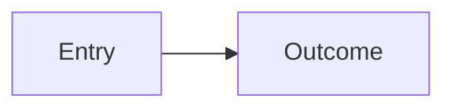

# Experience: <title>
Source: intent/<slug>/intent.md (accepted <date>)
Status: draft | accepted

## Primary journey
Entry:
First information and why:
Actions and feedback:
Outcome and verification:

## Screens and information priority
Describe each screen, its component hierarchy, and what appears first.

## Interaction states
Loading:
Empty:
Success:
Validation:
System error:
Partial failure:
Permission denied:

## Confirmation, recovery and destructive actions
## Navigation, accessibility and responsive behavior

## User flow

## UX acceptance criteria

### UX-001
Given:
When:
Then:

## Alternatives and trade-offs
Recommendation:
Alternative:
Trade-off:

## Assumptions and open questions
